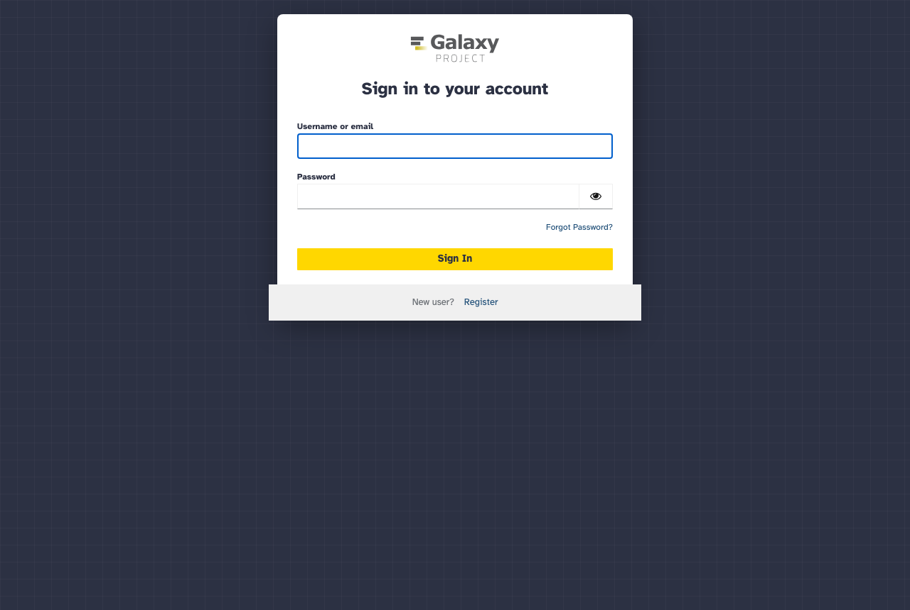
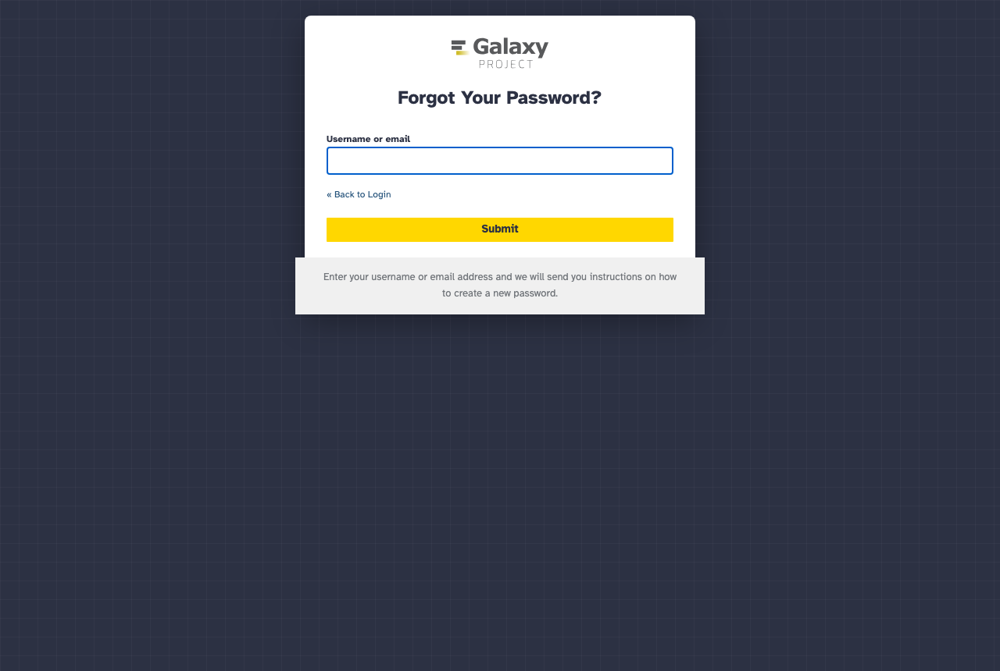
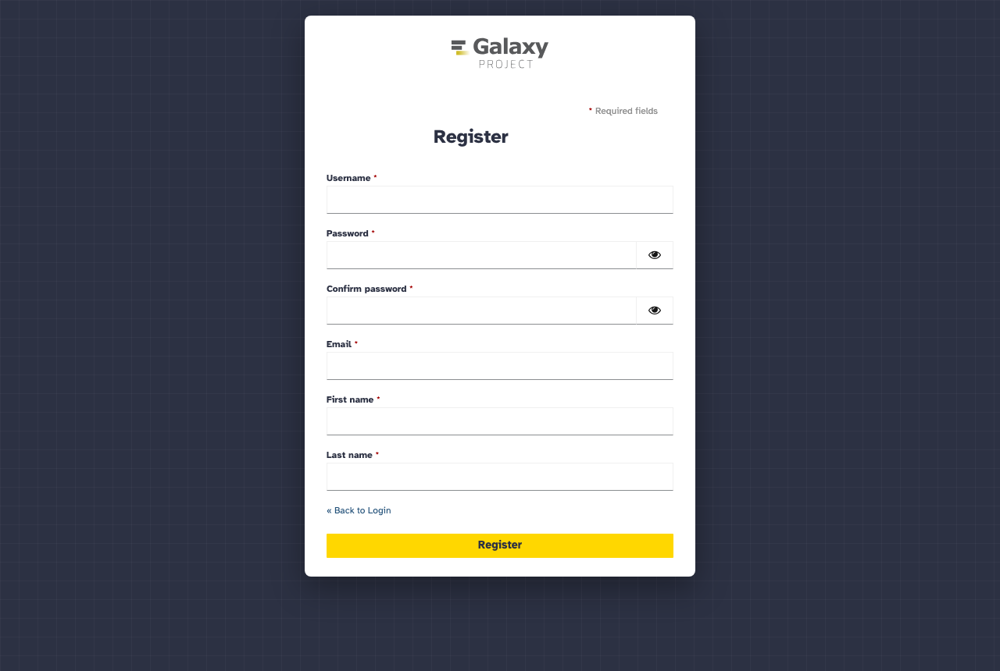
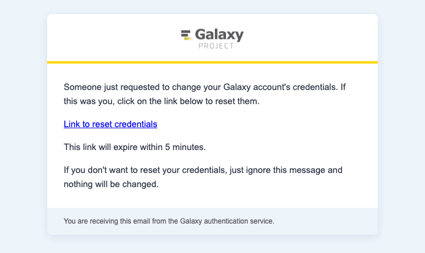

# galaxy-keycloak-theme

A Galaxy-branded Keycloak login and email theme. Theme id: `galaxy`. Built to
match the Galaxy design system -- dark stage, gold accent, Atkinson Hyperlegible
font. Pairs with the `auth.usegalaxy.org` Keycloak instance.

**Supported Keycloak versions:** 26.6.x (the version this theme is built and
tested against).

---

## Screenshots

The `galaxy` theme over Keycloak's standard login flows, plus the branded
transactional email wrapper -- captured from the `make dev` preview harness.



| Forgot password | Register | Branded reset email |
| --- | --- | --- |
|  |  |  |

---

## Local preview

`make dev` boots Keycloak and maildev via docker-compose with the theme mounted
live and caching disabled.

- Login preview: `http://localhost:8080/realms/galaxy-dev/account` -- click
  "Sign in" to reach the branded login page.
- Captured outbound emails: `http://localhost:1080` (maildev UI).

The dev realm (`dev/galaxy-dev-realm.json`) is wired to the `galaxy` login and
email themes, with a `testuser` (password `password`) and SMTP pointed at
maildev. `make smoke` runs the same boot and asserts the theme renders.

---

## Build

```bash
make build
# or, to pin the version string:
make build VERSION=1.2.3
```

Produces `dist/galaxy-keycloak-theme-<version>.jar`. The default version is
read from `VERSION` at the top of the Makefile.

---

## Installing in a Keycloak deployment

1. Download `galaxy-keycloak-theme-<version>.jar` from Releases.
2. Place it in the Keycloak container's `/opt/keycloak/providers/` directory.
3. In Realm Settings -> Themes, set **Login theme** and **Email theme** to `galaxy`
   (or set `loginTheme`/`emailTheme` in your realm provisioning).
4. Keep theme caching enabled in production (the default).

---

## Brand tokens / sync

The brand palette and font stack live in
`theme/galaxy/login/resources/css/tokens.css`. They are mirrored from
galaxy-hub `astro/src/styles/global.css` (the `@theme` block). Long-term, the
intent is to extract these into a shared `@galaxyproject/brand-tokens` package
consumed by both repos so updates propagate automatically.

Font used: **Atkinson Hyperlegible** -- bundled under
`theme/galaxy/login/resources/fonts/` and declared via `@font-face` in
`galaxy.css` so it works without a CDN.

---

## Email theme

Transactional emails (password reset, verification, etc.) are branded with the
Galaxy header. Email templates live under `theme/galaxy/email/`.

---

## Releasing

Push a `vX.Y.Z` tag; the `release` workflow (`.github/workflows/release.yml`)
builds the jar via `make build VERSION=X.Y.Z` and attaches it to a GitHub
Release automatically.

```bash
git tag v1.0.0
git push origin v1.0.0
```

---

## Repository layout

```
theme/galaxy/
  login/
    theme.properties           # parent=keycloak, styles list
    resources/
      css/    tokens.css, galaxy.css
      img/    galaxy_logo.svg
      fonts/  Atkinson Hyperlegible woff2 (400, 700)
  email/
    theme.properties           # parent=keycloak
    html/template.ftl          # branded email wrapper
META-INF/keycloak-themes.json  # declares theme id "galaxy", types login+email
Makefile                       # make build / dev / smoke
docker-compose.yml             # Keycloak 26.6.2 + maildev preview harness
dev/                           # dev realm, base-theme notes, accessibility notes
docs/screenshots/              # README preview images
scripts/                       # fetch-fonts.sh, smoke-test.sh
.github/workflows/             # ci.yml (smoke test), release.yml (jar on tag)
```
